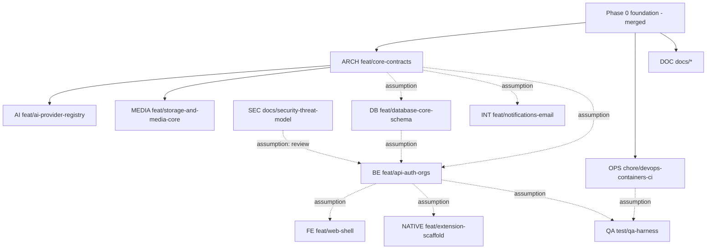

# Dependency graph

## Package dependencies (current code)

- apps/api → @meetops/logger, @meetops/config
- apps/web → React, Vite, TanStack Router
- apps/worker → @meetops/queue, @meetops/logger, @meetops/config
- @meetops/queue → bullmq, ioredis, @meetops/config, @meetops/logger
- @meetops/storage → aws sdk s3, @meetops/contracts
- @meetops/ai-core → contracts only (no providers yet)
- @meetops/database → prisma client (schema minimal)

## Phase 1 task graph

Solid edges come from the package graph above or repo docs (ADR-002, README). Dashed edges labelled "assumption" are inferred from the plan and have not been confirmed by the agents.

- ARCH → AI, ARCH → MEDIA: `@meetops/ai-core` and `@meetops/storage` build on `@meetops/contracts` (ADR-002).
- The rest are assumptions: the API needs the schema and contracts, the UI and extension call the API, email (INT) uses the shared contracts and queue, and QA needs CI and an API to test.
