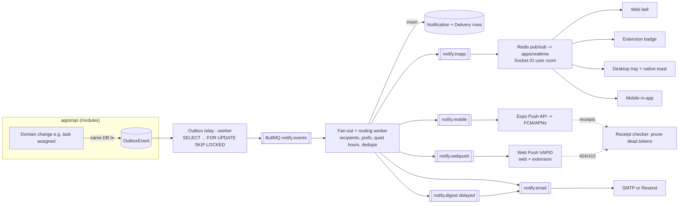

# Notifications architecture plan (all apps)

- Status: **Plan - for owner review** (docs only, no code). Companion decision: [ADR-013](../15-decisions/ADR-013-notifications-architecture.md) (Proposed).
- Date: 2026-10-27
- Scope: API, worker, realtime, web, browser extension (WXT, MV3), mobile (Expo 52 / RN 0.76), desktop (Tauri 2), email (SMTP + Resend).
- Owners: All Rounder (backend: API, worker, DB, providers), Coordinator (frontend: web, extension, mobile, desktop).

## 1. Where we are today (read from the repo, integration/phase-1 @ 4f197bb)

| Area          | Today                                                                                                                                                                                                                                                                                                          |
| ------------- | -------------------------------------------------------------------------------------------------------------------------------------------------------------------------------------------------------------------------------------------------------------------------------------------------------------- |
| Email         | `packages/notifications`: SMTP + console providers, templates, `queue.ts` (BullMQ `EMAIL_QUEUE`, 5 attempts, ids-only payloads), `unsubscribe-token.ts`. API default mailer is a no-op; fix in progress on `fix/email-delivery-wiring` (real mailer + Resend). `apps/worker` does not start an email consumer. |
| Outbox        | `OutboxEvent` model + `OutboxStatus` (pending/processing/published/failed) already in Prisma, org-scoped. No relay publishes it yet.                                                                                                                                                                           |
| Queue         | `packages/queue` (`createQueue`, `createWorker`, `createRedisClient`), BullMQ ^5.18, ioredis ^5.4.                                                                                                                                                                                                             |
| Realtime      | `apps/realtime`: Fastify 5 + Socket.IO 4.8 + `@socket.io/redis-adapter`, handshake auth per ADR-011 (session / extension / desktop credentials), `organizationRoom` and `meetingRoom`.                                                                                                                         |
| Tenancy       | `organizationId` (`org_id`) on every tenant row, composite `@@unique([organizationId, id])` (ADR-010); other-org ids are NOT_FOUND (ADR-004).                                                                                                                                                                  |
| Push / in-app | **None.** No device tokens, no feed, no preferences model. P1 lists "notification prefs + unsubscribe routes (user timezone)" as open; P4 lists task notifications as open.                                                                                                                                    |

## 2. Goals and non-goals

Goals

1. One pipeline for every channel: **in-app feed, realtime badge, Web Push (web + extension), mobile push, desktop native, email**.
2. Business code emits _domain events_ only; it never calls a channel directly.
3. Exactly-once _user-visible_ effect (idempotent at every hop), at-least-once delivery underneath.
4. Per-user, per-category, per-channel preferences; quiet hours in the user's timezone; digests.
5. Tenant isolation and no PII/secrets in push payloads, queues or logs.
6. Scale horizontally (stateless workers, Redis-backed queues) to ~1M notifications/day without redesign.
7. Self-hosted, no new paid vendor required; providers behind interfaces (ADR-002).

Non-goals (v1): SMS/WhatsApp, Slack/Teams DMs (later as extra channels), marketing campaigns, a visual template editor.

## 3. Event catalog (v1)

Category drives preferences. "Critical" = cannot be fully disabled (security/legal), email always on.

| Event type                                              | Category     | Recipients                              | Default channels             | Critical | Digestible     |
| ------------------------------------------------------- | ------------ | --------------------------------------- | ---------------------------- | -------- | -------------- |
| `auth.email_verification`                               | security     | the user                                | email                        | yes      | no             |
| `auth.password_reset`                                   | security     | the user                                | email                        | yes      | no             |
| `auth.new_device_login`                                 | security     | the user                                | email, in-app                | yes      | no             |
| `auth.account_locked` (ADR-006)                         | security     | the user                                | email                        | yes      | no             |
| `org.invitation_received`                               | org          | invitee (email only, may not be a user) | email                        | no       | no             |
| `org.role_changed`                                      | org          | the member                              | in-app, email                | no       | no             |
| `meeting.recording_uploaded`                            | meetings     | uploader                                | in-app, push                 | no       | no             |
| `meeting.processing_failed`                             | meetings     | uploader, org admins                    | in-app, push, email          | no       | no             |
| `meeting.report_ready` (summary/minutes)                | meetings     | participants with access                | in-app, push, email          | no       | yes            |
| `meeting.starting_soon` (desktop/extension capture)     | meetings     | participants                            | push, desktop                | no       | no             |
| `task.assigned`                                         | tasks        | assignee                                | in-app, push, email          | no       | yes            |
| `task.approval_requested`                               | tasks        | approvers                               | in-app, push, email          | no       | no             |
| `task.approved` / `task.rejected`                       | tasks        | creator, assignee                       | in-app, push                 | no       | yes            |
| `task.due_soon` / `task.overdue`                        | tasks        | assignee                                | in-app, push, email (digest) | no       | yes            |
| `comment.mention`                                       | mentions     | mentioned user                          | in-app, push, email          | no       | yes            |
| `integration.sync_failed` / `integration.token_expired` | integrations | integration owner, org admins           | in-app, email                | no       | no (dedupe 6h) |
| `billing.*` (later)                                     | billing      | org owners                              | email, in-app                | yes      | no             |
| `system.announcement`                                   | product      | everyone (opt-out)                      | in-app                       | no       | yes            |

Every event has: `eventId` (uuid, idempotency key), `type`, `organizationId`, `actorId`, `subject {type,id}`, `occurredAt`, `version`, minimal ids-only `data`. Schema lives in `packages/contracts` (TypeBox, like `EmailJobPayload`).

## 4. Architecture



Why this shape

- **Transactional outbox** (table already exists) removes the dual-write problem: the event is committed with the domain change or not at all [1][2].
- **Separate queue per channel** isolates slow/failed providers (an SMTP outage never blocks in-app) and lets us rate-limit per provider with BullMQ's queue limiter [3][4].
- **In-app is the system of record**; push/email are "pointers" to it. Every push opens a deep link to the in-app item, so payloads carry no content beyond a short title.
- Fits ADR-001 (modular monolith): a `notifications` module in the API + consumers in `apps/worker`; no new service.

### 4.1 Delivery sequence

```mermaid
sequenceDiagram
  participant API
  participant DB as Postgres
  participant Relay
  participant FanOut
  participant Ch as Channel worker
  participant Prov as Provider
  API->>DB: tx{ update task; insert OutboxEvent(eventId) }
  Relay->>DB: claim pending (SKIP LOCKED), add job jobId=eventId
  Relay->>DB: mark published
  FanOut->>DB: resolve recipients (same org only), load prefs
  FanOut->>DB: upsert Notification (unique org,user,dedupeKey)
  FanOut->>Ch: add job jobId=deliveryId (per channel)
  Ch->>Prov: send (idempotency key = deliveryId)
  Prov-->>Ch: ok / transient / permanent
  Ch->>DB: Delivery.status = sent | retrying | failed | suppressed
```

### 4.2 Idempotency, retries, DLQ

- `jobId = eventId` (relay) and `jobId = deliveryId` (channels) → BullMQ drops duplicates [3].
- `Notification @@unique([organizationId, userId, dedupeKey])`; `dedupeKey` defaults to `eventId`, or e.g. `integration.sync_failed:<integrationId>:<6h bucket>` to collapse floods.
- Retries: exponential backoff with jitter, 5 attempts (email/push), 3 (in-app). Permanent errors (invalid token, 410 Gone, hard bounce) throw `UnrecoverableError` (pattern already in `queue.ts`).
- DLQ: failed jobs kept 7 days (`removeOnFail: {age}`), `Delivery.status=failed`, metric + alert; admin replay script re-enqueues by deliveryId (same pattern as ADR-007 webhook replay).
- Resend supports an `Idempotency-Key` header [8]; SMTP uses `Message-ID = deliveryId@domain`.

## 5. Data model (Prisma proposal)

All org-scoped per ADR-010 with composite uniques; ids only, no rendered content stored beyond title/body for the feed.

```prisma
enum NotificationChannel { in_app web_push mobile_push desktop email }
enum DeliveryStatus { queued sent delivered failed suppressed }
enum DevicePlatform { web extension ios android desktop }

model Notification {
  id             String   @id @default(uuid()) @db.Uuid
  organizationId String   @map("org_id") @db.Uuid
  userId         String   @map("user_id") @db.Uuid
  eventId        String   @map("event_id") @db.Uuid
  type           String                    // e.g. task.assigned
  category       String
  dedupeKey      String   @map("dedupe_key")
  title          String                    // rendered, short, no secrets
  body           String?
  actionUrl      String?  @map("action_url") // relative deep link
  subjectType    String?  @map("subject_type")
  subjectId      String?  @map("subject_id") @db.Uuid
  groupKey       String?  @map("group_key")  // collapse "3 new tasks"
  readAt         DateTime? @map("read_at") @db.Timestamptz(3)
  seenAt         DateTime? @map("seen_at") @db.Timestamptz(3)  // badge cleared
  archivedAt     DateTime? @map("archived_at") @db.Timestamptz(3)
  createdAt      DateTime @default(now()) @map("created_at") @db.Timestamptz(3)
  expiresAt      DateTime? @map("expires_at") @db.Timestamptz(3)
  deliveries     NotificationDelivery[]
  @@unique([organizationId, id])
  @@unique([organizationId, userId, dedupeKey])
  @@index([organizationId, userId, createdAt(sort: Desc), id])   // feed keyset
  @@index([organizationId, userId, readAt])                       // unread count
  @@map("notifications")
}

model NotificationDelivery {
  id             String   @id @default(uuid()) @db.Uuid
  organizationId String   @map("org_id") @db.Uuid
  notificationId String   @map("notification_id") @db.Uuid
  channel        NotificationChannel
  deviceId       String?  @map("device_id") @db.Uuid
  status         DeliveryStatus @default(queued)
  attempts       Int      @default(0)
  providerRef    String?  @map("provider_ref")
  lastError      String?  @map("last_error")   // redacted code only
  sentAt         DateTime? @map("sent_at") @db.Timestamptz(3)
  createdAt      DateTime @default(now()) @map("created_at") @db.Timestamptz(3)
  notification   Notification @relation(fields: [organizationId, notificationId], references: [organizationId, id], onDelete: Cascade)
  @@unique([organizationId, id])
  @@index([organizationId, status, createdAt])
  @@map("notification_deliveries")
}

model NotificationPreference {
  id             String  @id @default(uuid()) @db.Uuid
  organizationId String  @map("org_id") @db.Uuid
  userId         String  @map("user_id") @db.Uuid
  category       String                  // "*" = global
  channel        NotificationChannel
  enabled        Boolean
  digest         String  @default("off") // off | hourly | daily
  @@unique([organizationId, userId, category, channel])
  @@map("notification_preferences")
}

model NotificationSettings {           // per user per org
  organizationId String  @map("org_id") @db.Uuid
  userId         String  @map("user_id") @db.Uuid
  timezone       String  @default("UTC")   // IANA, e.g. Asia/Kolkata
  quietStart     String? @map("quiet_start") // "22:00"
  quietEnd       String? @map("quiet_end")
  locale         String  @default("en")
  emailUnsubscribedAt DateTime? @map("email_unsubscribed_at") @db.Timestamptz(3)
  @@id([organizationId, userId])
  @@map("notification_settings")
}

model PushDevice {
  id             String   @id @default(uuid()) @db.Uuid
  userId         String   @map("user_id") @db.Uuid
  sessionId      String?  @map("session_id") @db.Uuid  // revoked with the session
  platform       DevicePlatform
  token          String                    // Expo token or WebPush endpoint, encrypted at rest (ADR-008 key)
  tokenHash      String   @unique @map("token_hash")
  p256dh         String?                   // web push keys (encrypted)
  auth           String?
  appVersion     String?  @map("app_version")
  lastSeenAt     DateTime @map("last_seen_at") @db.Timestamptz(3)
  disabledAt     DateTime? @map("disabled_at") @db.Timestamptz(3)
  createdAt      DateTime @default(now()) @map("created_at") @db.Timestamptz(3)
  @@index([userId, disabledAt])
  @@map("push_devices")
}
```

Notes: `PushDevice` is user-scoped (a phone serves all the user's orgs); fan-out only sends to devices of users who are members of the event's org, and the payload carries `orgId` so the client switches org on tap. Retention: feed rows 90 days (cron delete by `createdAt`), deliveries 30 days; partition `notifications` by month once it passes ~50M rows.

## 6. API contracts (REST, under existing auth + org guard)

| Method   | Path                                                                 | Notes                                                                                 |
| -------- | -------------------------------------------------------------------- | ------------------------------------------------------------------------------------- |
| GET      | `/orgs/:orgId/notifications?cursor=&limit=&unread=`                  | keyset pagination on (createdAt,id), max 50                                           |
| GET      | `/orgs/:orgId/notifications/unread-count`                            | `{ count, latestAt }`, cached in Redis `notif:unread:{org}:{user}`                    |
| POST     | `/orgs/:orgId/notifications/:id/read` · `/read-all` · `/:id/archive` | idempotent; emits realtime `notification.read` to user's other devices                |
| POST     | `/orgs/:orgId/notifications/seen`                                    | clears badge (seenAt) without marking read                                            |
| GET/PUT  | `/orgs/:orgId/me/notification-preferences`                           | matrix category × channel + digest; critical rows read-only                           |
| GET/PUT  | `/orgs/:orgId/me/notification-settings`                              | timezone, quiet hours, locale                                                         |
| POST     | `/me/push-devices`                                                   | `{platform, token                                                                     | subscription{endpoint,keys}}`; upsert by tokenHash; bound to current session |
| DELETE   | `/me/push-devices/:id`                                               | on sign-out / permission revoked                                                      |
| GET      | `/push/vapid-public-key`                                             | public key only                                                                       |
| GET/POST | `/unsubscribe?token=`                                                | signed token (`unsubscribe-token.ts`), RFC 8058 one-click `List-Unsubscribe-Post` [9] |

Realtime (Socket.IO, ADR-011): server joins each socket to `user:{orgId}:{userId}` room; events `notification.new {id,title,actionUrl,createdAt}`, `notification.read {ids}`, `notification.count {count}`. The worker publishes via the Redis adapter's emitter, so any realtime pod reaches the user [5].

## 7. Delivery pipeline details

1. **Relay** (worker, every 500 ms + LISTEN/NOTIFY wake-up): claim up to 500 `pending` rows with `FOR UPDATE SKIP LOCKED`, enqueue, mark `published`; stuck `processing` > 5 min reset. Multiple relays are safe.
2. **Fan-out** resolves recipients via a per-event _recipient resolver_ (registry in code, e.g. `task.assigned → [assigneeUserId]`), filters: membership in org still active, user ≠ actor (no self-notify), access check on the subject (reuse meeting-access rules). Large audiences (org announcements) fan out in chunks of 1000 child jobs (BullMQ flows) [3].
3. **Routing** per recipient: default channels for the event → minus disabled prefs → critical overrides → quiet hours (push/desktop held until quietEnd in user TZ via delayed job; in-app always immediate; security never held) → digest (if category digest ≠ off, add to `digest:{org}:{user}:{window}` Redis list and schedule one delayed digest job, `jobId` = window key).
4. **Render** with templates per (type, channel, locale): reuse `templates.ts` for email; short title/body strings for push (≤ 120 chars, no meeting content / transcript text / emails).
5. **Send** via channel workers with BullMQ `limiter` (e.g. Expo 600/s per project [6], Gmail SMTP ~ 20/min safe for dev, Resend per plan [8]); group by `groupKey` to collapse bursts ("3 new tasks in Project X").
6. **Feedback**: Expo push receipts checked after 15 min (`DeviceNotRegistered` → disable device) [6]; Web Push 404/410 → disable subscription [7]; email bounces/complaints from Resend webhooks → `emailUnsubscribedAt`/suppression list.

## 8. Per-app client design (Coordinator)

All UI follows `docs/references.md`: dark-first `#0A0A0A`, cerulean `#007BA7` fills, `#3AB0E0` text/focus rings, **Neon Rose `#FF2D95` only for the unread dot/badge**, `#EF4444` only for errors (never rose), shadcn/ui primitives restyled, WCAG AA, reduced-motion respected.

| App                                              | Design                                                                                                                                                                                                                                                                                                                                                                                                                                                                                                                                                                                                 |
| ------------------------------------------------ | ------------------------------------------------------------------------------------------------------------------------------------------------------------------------------------------------------------------------------------------------------------------------------------------------------------------------------------------------------------------------------------------------------------------------------------------------------------------------------------------------------------------------------------------------------------------------------------------------------ |
| **Web** (Vite + React 18, TanStack Router/Query) | Bell in top bar with rose count badge (caps "99+"); Popover feed (shadcn Popover + ScrollArea), tabs All/Unread, infinite query on the feed endpoint, optimistic mark-read; full `/notifications` page; Settings → Notifications matrix (category × channel toggles, digest select, timezone + quiet hours). Socket `notification.new` → `queryClient.setQueryData` + toast (sonner). Web Push: service worker `sw.js`, ask permission only after a user gesture from a soft prompt ("Get notified when reports are ready"), never on load; subscribe with VAPID public key → `POST /me/push-devices`. |
| **Extension** (WXT, MV3)                         | Background service worker subscribes `registration.pushManager.subscribe({userVisibleOnly:true})` and shows `self.registration.showNotification` (or `chrome.notifications`); click opens the web deep link. Badge via `chrome.action.setBadgeText` + rose `setBadgeBackgroundColor`. MV3 workers are ephemeral, so no long-lived socket: unread count fetched on popup open + via push event [10]. Needs `notifications` permission (manifest change → store review).                                                                                                                                 |
| **Mobile** (Expo 52 / RN 0.76)                   | `expo-notifications`: request permission after onboarding soft prompt, `getExpoPushTokenAsync({projectId})` → register; Android channels per category (Security high, Meetings default, Tasks default); notification response listener → deep link via router; in-app feed screen + tab badge; `setBadgeCountAsync` from unread count; re-register token on every app start (tokens rotate) [6]. Requires EAS project, FCM v1 credentials and APNs key (owner decision).                                                                                                                               |
| **Desktop** (Tauri 2)                            | While running: Socket.IO connection (desktop credential, ADR-012) → `@tauri-apps/plugin-notification` native toast + tray badge/menu "N unread" [11]. Not running: rely on email/mobile (no OS push for desktop apps in v1). Needs capability `notification:default` added to `capabilities/default.json`.                                                                                                                                                                                                                                                                                             |

## 9. Preferences, quiet hours, digests

- Resolution order: critical override → per-category/channel row → global `*` row → event default.
- Quiet hours computed with IANA TZ (handles DST); default timezone captured from the browser at signup (`Intl.DateTimeFormat().resolvedOptions().timeZone`).
- Digests: hourly or daily (09:00 user TZ) email summarising unread digestible items; skip if all were read in-app already (check `readAt` at send time).
- Email unsubscribe: per-category link + global; one-click RFC 8058 headers; security emails exempt.
- "Read on one device clears everywhere": read events broadcast over realtime; push uses collapse/tag = notificationId so newer replaces older.

## 10. Scaling and capacity

| Load (assumption)                                                       | Sizing                                                                                                                                                                        |
| ----------------------------------------------------------------------- | ----------------------------------------------------------------------------------------------------------------------------------------------------------------------------- |
| 1k orgs, 50k users, ~20 notifs/user/day ≈ 1M/day ≈ 12/s avg, 200/s peak | 1 relay + 2 fan-out + 1 per channel worker pod (concurrency 20-50 each)                                                                                                       |
| Postgres                                                                | ~1M feed rows/day → 90M at 90 days → monthly partitions + retention job; feed query is index-only on `(org,user,createdAt desc,id)`                                           |
| Redis                                                                   | BullMQ keys short-lived (`removeOnComplete` count/age); separate logical DB or instance from Socket.IO adapter at scale; `maxmemory-policy noeviction` required by BullMQ [3] |
| Realtime                                                                | Socket.IO + Redis adapter already horizontal; sticky sessions on LB                                                                                                           |
| Unread count                                                            | Redis counter incremented by fan-out, decremented on read, rebuilt from DB on miss                                                                                            |

Horizontal scaling = more worker replicas (stateless); partition hot queues by `org_id % N` only if one org dominates (BullMQ Pro groups not needed in v1).

## 11. Security

- Tenant isolation: every query filters `organizationId`; recipients re-checked against current membership and subject access at fan-out time (a removed member gets nothing); other-org ids → NOT_FOUND (ADR-004).
- Payloads: ids + short generic title only; no transcript/summary text, emails, tokens in push (Apple/Google/Expo and browser push services see the payload). Web Push payloads are encrypted (RFC 8291) but still minimal.
- Device tokens encrypted at rest (ADR-008 KMS key), bound to session, deleted on sign-out and on ADR-011 revocation.
- Secrets: `VAPID_PRIVATE_KEY`, `EXPO_ACCESS_TOKEN`, `RESEND_API_KEY`, `SMTP_PASSWORD` only in env/secret store; added to `REDACT_KEYS`.
- Deep links are relative paths validated against an allowlist (no open redirect). Unsubscribe tokens signed + expiring.
- Rate-limit device registration and preference writes; audit-log preference changes for security category.

## 12. Observability

- Metrics (Prometheus/OTel): `notif_events_total{type}`, `notif_deliveries_total{channel,status}`, `notif_e2e_latency_seconds` (occurredAt → sent), queue depth/age per queue, outbox lag (oldest pending), invalid-token rate, bounce rate.
- Tracing: propagate `traceparent` from API tx through outbox payload to channel jobs.
- Logs: structured with `eventId`, `deliveryId`, `orgId`; never token/email/body (logger redaction).
- Alerts: outbox lag > 60 s, DLQ > 50/h, email bounce > 5%, push failure > 10%.
- Bull Board (admin-only, behind auth) for queue inspection.

## 13. Build vs buy

| Option                                  | Pros                                                                                                           | Cons                                                                                                              | Verdict                                                |
| --------------------------------------- | -------------------------------------------------------------------------------------------------------------- | ----------------------------------------------------------------------------------------------------------------- | ------------------------------------------------------ |
| **Self-built on BullMQ (recommended)**  | Already have Postgres outbox, BullMQ, Socket.IO; full control of tenancy & data residency; no per-message cost | We build prefs/digest UI ourselves                                                                                | **Yes**                                                |
| Novu (OSS, self-hostable) [12]          | Workflows, inbox component, digests                                                                            | Extra service (Mongo + Redis + several apps), its own tenancy model, inbox UI would need re-skinning to our theme | Re-evaluate if channels grow                           |
| Knock / Courier / OneSignal (SaaS) [13] | Fast, polished                                                                                                 | Per-MAU cost, user data leaves our infra, vendor lock-in                                                          | No for v1                                              |
| Firebase FCM direct vs Expo Push        | FCM: no middleman                                                                                              | Expo Push wraps FCM+APNs with one token type, free, fits Expo app [6]                                             | Expo Push; keep `PushProvider` interface to swap later |

## 14. Rollout plan and task split

| Phase                   | All Rounder (backend)                                                                                                                                                                                | Coordinator (frontend)                                                  | Est.                |
| ----------------------- | ---------------------------------------------------------------------------------------------------------------------------------------------------------------------------------------------------- | ----------------------------------------------------------------------- | ------------------- |
| N0 Email works          | Finish `fix/email-delivery-wiring` (SMTP + Resend), start email consumer in `apps/worker`                                                                                                            | Email template screenshots review                                       | 1-2 d (in progress) |
| N1 Foundation           | Contracts (event + job schemas), Prisma models + migration, outbox relay, fan-out/routing worker, recipient registry, in-app channel, feed/count/read REST, realtime `user:` room + emitter, metrics | Web bell + popover + `/notifications` page, socket wiring, unread badge | 5-6 d BE / 3-4 d FE |
| N2 Preferences          | Prefs/settings REST, quiet hours, unsubscribe routes (RFC 8058), digest scheduler                                                                                                                    | Settings → Notifications matrix, timezone/quiet hours UI                | 3 d / 2 d           |
| N3 Web + extension push | VAPID keys config, `web-push` provider, device REST, 410 pruning                                                                                                                                     | Web SW + soft prompt; extension SW push + badge + manifest permission   | 3 d / 3 d           |
| N4 Mobile push          | Expo push provider, receipts job, token lifecycle                                                                                                                                                    | expo-notifications, Android channels, deep links, feed screen, badge    | 3 d / 3 d           |
| N5 Desktop              | (none new; realtime)                                                                                                                                                                                 | Tauri notification plugin, tray badge, capability                       | — / 2 d             |
| N6 Events wired         | Emit outbox events from auth, meetings (report ready/failed), tasks (P4), integrations, mentions                                                                                                     | Deep-link targets for each event                                        | 3 d / 1 d           |
| N7 Hardening            | Load test (k6) 200/s, DLQ replay script, retention/partition jobs, alerts, runbook `docs/16-runbooks/notifications.md`                                                                               | E2E (Playwright) bell + prefs, a11y audit                               | 3 d / 2 d           |

Total ≈ 21-24 BE days, ≈ 16-18 FE days, can run in parallel after N1 contracts land. One lockfile-changing PR at a time (`web-push`, `expo-notifications`, `@tauri-apps/plugin-notification`, `expo-server-sdk` optional — can use `fetch` instead).

## 15. Open decisions for the owner

1. Approve **self-built on BullMQ + outbox** (vs Novu/Knock).
2. Mobile push via **Expo Push** (needs EAS project id, FCM v1 service account, APNs .p8 key, Apple team).
3. Web Push **VAPID** keys generation and storage; contact `mailto:` for VAPID subject.
4. Extension `notifications` permission (triggers Chrome Web Store re-review).
5. Retention: feed 90 days / deliveries 30 days OK?
6. Which events are "critical" (cannot be disabled) — proposal: security + billing only.
7. Default digest: daily 09:00 local for tasks/mentions? Default quiet hours off or 22:00-07:00?
8. Email provider in prod: Resend (needs verified domain) vs Gmail SMTP (dev only; daily send caps).
9. Push content policy: generic titles only (recommended) vs include meeting/task names.
10. Locales beyond English for v1?

## 16. Sources

1. Chris Richardson, _Transactional outbox_ — https://microservices.io/patterns/data/transactional-outbox.html
2. PostgreSQL `SELECT ... FOR UPDATE SKIP LOCKED` — https://www.postgresql.org/docs/current/sql-select.html#SQL-FOR-UPDATE-SHARE
3. BullMQ docs: job ids/dedup, retries & backoff, rate limiting, flows, production (noeviction) — https://docs.bullmq.io/guide/jobs/job-ids · https://docs.bullmq.io/guide/retrying-failing-jobs · https://docs.bullmq.io/guide/rate-limiting · https://docs.bullmq.io/guide/flows · https://docs.bullmq.io/guide/going-to-production
4. AWS Builders' Library, _Timeouts, retries and backoff with jitter_ — https://aws.amazon.com/builders-library/timeouts-retries-and-backoff-with-jitter/
5. Socket.IO Redis adapter & emitter — https://socket.io/docs/v4/redis-adapter/ · https://socket.io/docs/v4/redis-emitter/
6. Expo push notifications (sending, receipts, rate limits, token lifecycle) — https://docs.expo.dev/push-notifications/sending-notifications/ · https://docs.expo.dev/push-notifications/overview/
7. Web Push: MDN Push API, RFC 8030, RFC 8291, RFC 8292 (VAPID), web.dev — https://developer.mozilla.org/en-US/docs/Web/API/Push_API · https://datatracker.ietf.org/doc/html/rfc8292 · https://web.dev/articles/push-notifications-overview
8. Resend API (idempotency keys, webhooks) — https://resend.com/docs/dashboard/emails/idempotency-keys · https://resend.com/docs/dashboard/webhooks/introduction
9. RFC 8058 one-click unsubscribe; Google bulk sender guidelines — https://datatracker.ietf.org/doc/html/rfc8058 · https://support.google.com/a/answer/81126
10. Chrome extensions: push in MV3 service workers, `chrome.notifications`, `chrome.action` badge — https://developer.chrome.com/docs/extensions/how-to/integrate/web-push · https://developer.chrome.com/docs/extensions/reference/api/notifications
11. Tauri 2 notification plugin — https://v2.tauri.app/plugin/notification/
12. Novu (open source notification infrastructure) — https://docs.novu.co/
13. Knock — https://docs.knock.app/ ; OneSignal — https://documentation.onesignal.com/
