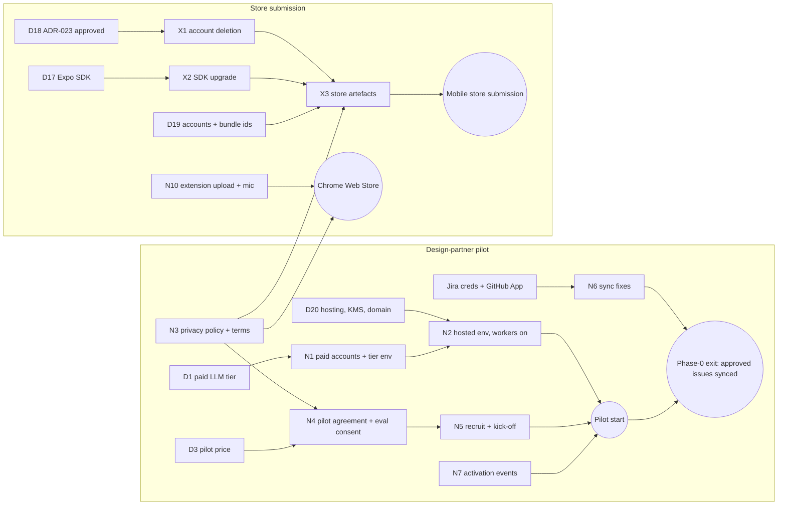

# Phase-2 roadmap synthesis (research briefs → one plan)

- Checked: **2026-11-18 (IST)** against `integration/phase-1` at `a83b82ce` (the #518 merge; code unchanged since
  `2127fb46`). Open-PR state was read from GitHub on 2026-11-18 at about 14:50 IST.
- **What this is:** one prioritised list that links back to the briefs. It doesn't restate them. Every row links its
  source section; the source carries the evidence.
- Labels:
  - **ESTIMATE**: our sizing, with its basis.
  - **PROPOSAL**: a recommendation, not a decision.
  - **INFERRED**: our reading.
  - **UNVERIFIED**: not confirmed.
- **Not legal advice.** Counsel items are indexed in §6, not answered.
- **Inputs:**
  - [two-way-sync-since-last-meeting-brief.md](two-way-sync-since-last-meeting-brief.md) (#511);
  - [pricing-packaging-v2.md](pricing-packaging-v2.md) (#512);
  - [onboarding-activation-teardown.md](onboarding-activation-teardown.md) (#515);
  - [account-deletion-erasure-brief.md](account-deletion-erasure-brief.md) (#508);
  - [capture-platform-policy.md](capture-platform-policy.md), including §6 (#501, #506);
  - [ai-provider-due-diligence.md](ai-provider-due-diligence.md) (#489);
  - [design-partner-kit/](design-partner-kit/README.md) (#498);
  - [legal-questions-brief.md](legal-questions-brief.md);
  - [oauth-verification-readiness.md](oauth-verification-readiness.md) (#518, merged as `a83b82ce`), called "OAuth
    brief" below.
- **Repo status inputs:**
  - `docs/PHASE_STATUS.md`, the 12 Nov update (L3–32);
  - `docs/HANDOFF.md` §5 (L68–78) and §6;
  - `docs/p9/remaining-work.md`;
  - the merge log and open PRs at `a83b82ce` (§1).

## 1. What's already done or in progress (don't re-propose)

| Area                                 | State at `a83b82ce`                                                                                                                                                   | Evidence                                                                                                                                                                   |
| ------------------------------------ | --------------------------------------------------------------------------------------------------------------------------------------------------------------------- | -------------------------------------------------------------------------------------------------------------------------------------------------------------------------- |
| Provider tier guard                  | **Done.** Production refuses a free or undeclared LLM/STT tier unless `AI_PROVIDER_DATA_TIER_<NAME>` is set                                                           | #513; `packages/ai-core/src/provider-data-tier.ts` L120–135                                                                                                                |
| AssemblyAI provider deletes          | **Done for new transcripts**, per chunk. Sweep and backfill still open                                                                                                | 45e8664e, #514; [teardown §8](onboarding-activation-teardown.md#8-corrections-to-merged-briefs-after-513-dated-2026-11-18-subject-to-the-coordinators-no-objection) item 1 |
| Privacy-policy link (web, extension) | **Code done**, shown when the env URL is set. **No policy text or page exists**                                                                                       | #510 (`323fdc71`); [capture F2](capture-platform-policy.md#1-summary)                                                                                                      |
| Consent settings                     | Contracts **merged** (#483, `e5075890`). Web panel exists (`apps/web/src/features/settings/settings-page.tsx` L29–30). API and rate limits **in review** (#484, #485) | PHASE_STATUS L32; open PRs                                                                                                                                                 |
| MFA (ADR-021)                        | **In review** (#490, #491, #493, #497)                                                                                                                                | open PRs                                                                                                                                                                   |
| Account deletion                     | **ADR-023 proposed, in review** (#517). No code yet                                                                                                                   | #517; [deletion brief S1](account-deletion-erasure-brief.md#1-summary)                                                                                                     |
| Extension microphone mix (F8)        | **In review** (#516)                                                                                                                                                  | open PRs; [capture §6.3](capture-platform-policy.md#63-f8-does-the-extension-miss-the-users-own-microphone)                                                                |
| Semantic search                      | Web UI **merged** (#500). The embeddings worker is **off by default** (`apps/worker/src/embeddings/index.ts` L30–33)                                                  | merge log                                                                                                                                                                  |
| Live Activity id (mobile)            | **Merged** (#494). **Native code still not compiled**                                                                                                                 | HANDOFF §6 item 1 (L87)                                                                                                                                                    |
| Google sign-in                       | **Done** (#459, #463). The calendar client is separate and still needs an owner (HANDOFF §5 item 1)                                                                   | HANDOFF L24, L70                                                                                                                                                           |
| Promote to `main`                    | **Open** (#462). Only Akash merges                                                                                                                                    | PHASE_STATUS L30                                                                                                                                                           |
| AI workers                           | Code exists. `TRANSCRIPTION_WORKER_ENABLED` and `AI_SUMMARY_WORKER_ENABLED` **default false** (`.env.example` L160, L163)                                             | [teardown §7 F3](onboarding-activation-teardown.md#7-code-findings-to-route-no-code-changed)                                                                               |

## 2. What this supersedes

- **[roadmap-plan.md](roadmap-plan.md) (2026-11-11):**
  - Its phase table (P1–P9 percentages) and day-0–90 windows are superseded by §3–§4 here. They used the
    PHASE_STATUS 7–9 Nov numbers.
  - Its feature rows (#1–#24) stay valid as **content**. They are mapped into Next or Later below by number.
  - **Changed:**
    - "#6 two-way sync GA" in days 0–30 now depends on fixing ordering and Jira inbound first (two-way brief K2, K3).
    - Store submission, account deletion and the pilot gates were missing. They are now Now and Next.
- **[EXECUTIVE-SUMMARY.md](EXECUTIVE-SUMMARY.md):**
  - Its "What to build first" is superseded by §3. Its "Top 10 bets" and "Why we win" stand.
  - Its project-lead decisions are unchanged and are referenced in §5 (Sarvam, consent default).

## 3. Roadmap

Effort is an ESTIMATE: S ≈ ≤ 3 engineer-days, M ≈ 1–2 engineer-weeks, L ≈ more than 2 engineer-weeks. The basis is
given per row (a source estimate where one exists, otherwise the scope of the linked outline). Owner teams are those
named in the source outline.

### 3.1 Now (next 2–3 weeks): design-partner pilot blockers

| ID  | Item                                                                                                      | Source                                                                                                                                                                                                                                                                        | Owner                                | Depends on                                                           | Effort (ESTIMATE, basis)                                        | Status                                                                |
| --- | --------------------------------------------------------------------------------------------------------- | ----------------------------------------------------------------------------------------------------------------------------------------------------------------------------------------------------------------------------------------------------------------------------- | ------------------------------------ | -------------------------------------------------------------------- | --------------------------------------------------------------- | --------------------------------------------------------------------- |
| N1  | Paid LLM and STT accounts for customer data; set `AI_PROVIDER_DATA_TIER_*`; AssemblyAI opt-out and TTL    | [AI DD §5.1](ai-provider-due-diligence.md#51-gemini-tier-for-customer-data), [§5.5](ai-provider-due-diligence.md#55-assemblyai-training-and-retention-input-for-51-style-decision); [pricing §6](pricing-packaging-v2.md#6-decision-points-for-akash-labelled-options) item 4 | Akash + AI                           | D1, D2; Gemini key (HANDOFF §5 item 3)                               | S (option A keeps the adapter and host, AI DD §5.1)             | Guard done (#513)                                                     |
| N2  | Hosted pilot environment with both AI workers on, KMS, backups and a domain                               | [teardown F3](onboarding-activation-teardown.md#7-code-findings-to-route-no-code-changed); `docs/p9/remaining-work.md` rows 3, 10, 17                                                                                                                                         | Akash + Backend                      | D20, N1                                                              | M (three needs-owner P9 rows plus a deploy; no source estimate) | Deploy interface merged (#449); target not chosen (PHASE_STATUS L130) |
| N3  | Privacy policy, terms and home page live; set `VITE_PRIVACY_URL`, `VITE_TERMS_URL` and `WXT_PRIVACY_URL`  | [capture F2](capture-platform-policy.md#1-summary); [OAuth brief](oauth-verification-readiness.md) §3.2–3.3                                                                                                                                                                   | Akash + counsel; Frontend for config | Counsel (§6)                                                         | S for config once the text exists                               | Link code done (#510)                                                 |
| N4  | Pilot agreement and eval consent form drafted by counsel                                                  | [pilot-agreement-outline.md](design-partner-kit/pilot-agreement-outline.md#decisions-needed); [eval protocol §10](design-partner-kit/hinglish-eval-data-protocol.md#10-decisions-needed)                                                                                      | Akash + counsel                      | D3, D4, D8                                                           | Counsel time (UNVERIFIED)                                       | Outlines exist                                                        |
| N5  | Recruit the cohort and run discovery interviews                                                           | [icp §6–§9](design-partner-kit/icp-and-recruitment.md#6-cohort-size-and-mix-proposal); [interview script](design-partner-kit/interview-script.md)                                                                                                                             | Akash                                | D5, D6, N4                                                           | 2-week baseline + 6 weeks of use per team (icp §6)              | Not started                                                           |
| N6  | Two-way sync correctness: monotonic, echo-safe status apply (C1); Jira OAuth webhook JWT and refresh (C2) | [two-way §11](two-way-sync-since-last-meeting-brief.md#11-code-findings-to-route-no-code-changed) C1, C2; K2, K3                                                                                                                                                              | Integrations + Backend               | Jira credentials (HANDOFF §5 item 9); GitHub App install (§5 item 2) | M (two worker jobs plus a route change from two-way §9)         | Not started                                                           |
| N7  | Server-side activation events, no PII, so pilot metrics have a baseline                                   | [teardown §6](onboarding-activation-teardown.md#6-activation-metrics-to-instrument-proposal-no-pii); [pilot metrics §2](design-partner-kit/pilot-success-metrics.md#2-baseline-capture-proposal)                                                                              | Backend                              | D7                                                                   | M (about 14 events on the existing outbox, teardown §6)         | Not started (teardown F9)                                             |
| N8  | Pilot calendar: Google project in Testing with listed test users; decide the project layout               | [OAuth brief](oauth-verification-readiness.md) §4                                                                                                                                                                                                                             | Akash + Integrations                 | D9; calendar client (HANDOFF §5 item 1)                              | S (console setup)                                               | Calendar code done; client missing                                    |
| N9  | Land consent-settings API and rate limits                                                                 | #484, #485                                                                                                                                                                                                                                                                    | Backend + Security                   | Review                                                               | — (in review)                                                   | In review                                                             |
| N10 | Extension usable in the pilot: production HTTP upload (F2) and microphone mix (#516)                      | [teardown F2](onboarding-activation-teardown.md#7-code-findings-to-route-no-code-changed); [capture §6.3](capture-platform-policy.md#63-f8-does-the-extension-miss-the-users-own-microphone)                                                                                  | Extension                            | A real-meeting test of #516 (UNVERIFIED, capture §5)                 | S for F2 (build flag)                                           | #516 in review                                                        |
| N11 | AssemblyAI delete sweep for final failures, plus a backfill                                               | [teardown §8](onboarding-activation-teardown.md#8-corrections-to-merged-briefs-after-513-dated-2026-11-18-subject-to-the-coordinators-no-objection) item 1; ADR-023 (#517)                                                                                                    | AI                                   | —                                                                    | S–M (one repeatable job)                                        | Deletes done; sweep open                                              |

### 3.2 Next (about weeks 3–8): store submission, verification, first-run

| ID  | Item                                                                                                                                                                                                        | Source                                                                                                                    | Owner                                     | Depends on                            | Effort (ESTIMATE, basis)                                                                    | Status                                                                                                      |
| --- | ----------------------------------------------------------------------------------------------------------------------------------------------------------------------------------------------------------- | ------------------------------------------------------------------------------------------------------------------------- | ----------------------------------------- | ------------------------------------- | ------------------------------------------------------------------------------------------- | ----------------------------------------------------------------------------------------------------------- |
| X1  | Account deletion per ADR-023: API, purge job, tombstones, web flow, public page, mobile entry                                                                                                               | [deletion brief §7](account-deletion-erasure-brief.md#7-task-outline-per-team-proposal); ADR-023 (#517)                   | Backend, Frontend, Native/mobile, AI      | D18; counsel Q29–Q33                  | L (five teams' tasks in brief §7)                                                           | ADR in review                                                                                               |
| X2  | Expo SDK upgrade to one that targets Android API 36 and builds on Xcode 26                                                                                                                                  | [capture §6.1](capture-platform-policy.md#61-expo-sdk-52-android-target-and-xcode-f3-f4); `docs/plans/expo-rn-upgrade.md` | Native/mobile                             | D17                                   | L (the plan says 4.5–7 engineer-days for SDK 55 alone, `expo-rn-upgrade.md` L22; see §7 C1) | Plan exists                                                                                                 |
| X3  | Store artefacts: iOS privacy manifest (F6), Play foreground-service declaration (F7), Data safety and `store-review.md` (F9), bundle ids, macOS `Info.plist` and entitlements (F5)                          | [capture §1, §4](capture-platform-policy.md#4-build-tasks-this-unblocks-proposals-not-assigned); HANDOFF §5 item 4        | Native/mobile, Desktop                    | X1 (F9 says deletion exists), X2, D19 | M (several small config files and forms)                                                    | Not started                                                                                                 |
| X4  | Calendar data minimisation before Google review: `fields=`, drop `calendarlist.readonly`, attendee count only                                                                                               | [OAuth brief](oauth-verification-readiness.md) §2.3, §8 C1, C3, C4                                                        | Integrations + Security                   | Security review (`calendar.ts` L98)   | S                                                                                           | Not started                                                                                                 |
| X5  | Google brand and sensitive-scope verification; Microsoft publisher verification and an admin-consent help page                                                                                              | [OAuth brief](oauth-verification-readiness.md) §6 items 1–17                                                              | Akash + Docs                              | N3, X4, D22                           | About 3–5 weeks elapsed (OAuth brief §6 ESTIMATE)                                           | Not started                                                                                                 |
| X6  | First-run fixes: auto personal org (P5), upload-first and sample (P3, P4), meeting-optional Start (P6), summary-ready signal (P2), empty states (P12), desktop browser auth (P10, F6), mobile org (P11, F7) | [teardown §5](onboarding-activation-teardown.md#5-gaps-and-proposals-proposal-nothing-decided)                            | Frontend, Backend, Native/mobile, Desktop | Security review for P5 and P8         | L (teardown §5.5 spans four teams)                                                          | Not started                                                                                                 |
| X7  | Two-way sync completion: reconciliation and redelivery jobs, status mappings, status-mapping admin page                                                                                                     | [two-way §9](two-way-sync-since-last-meeting-brief.md#9-outlines-per-team-proposals)                                      | Integrations, Backend, Frontend           | N6                                    | L (§9 lists five worker jobs and new tables)                                                | Not started                                                                                                 |
| X8  | Storage follow-ups: delete WAV copies after transcript, fix ADR-019's storage estimate; `speech_models` parameter                                                                                           | [pricing §8](pricing-packaging-v2.md#8-follow-ups-outside-docsresearch-for-the-coordinator-not-done-here)                 | AI + Backend                              | D10                                   | S                                                                                           | Not started                                                                                                 |
| X9  | MFA (ADR-021)                                                                                                                                                                                               | #490, #491, #493, #497                                                                                                    | Security + Backend                        | Review                                | — (in review)                                                                               | In review                                                                                                   |
| X10 | Spec 04 no-viral guarantee, spec 05 language settings, trust flags shown (roadmap-plan #4, #5, #8)                                                                                                          | [roadmap-plan days 0–30](roadmap-plan.md#days-030-trust-and-finishing-p3p4p5-all-p0); [specs](specs/README.md)            | Backend, Frontend, AI                     | D8 for Hindi eval                     | Spec 04 about 5–7 ew, spec 05 about 6–8 ew (specs README)                                   | Flags exist in the pipeline (`packages/ai-core/src/extraction/schemas.ts`); no web display found (INFERRED) |
| X11 | Billing and entitlements (ADR-017), pricing page                                                                                                                                                            | `docs/p9/remaining-work.md` rows 5–8; [pricing §4](pricing-packaging-v2.md#4-plan-proposals-proposal)                     | Backend, Frontend                         | D11, D12; Razorpay account            | L (four P9 rows)                                                                            | Not started                                                                                                 |

### 3.3 Later (after the pilot or before GA)

| ID  | Item                                                                                          | Source                                                                                                                        | Owner                           | Depends on                                   |
| --- | --------------------------------------------------------------------------------------------- | ----------------------------------------------------------------------------------------------------------------------------- | ------------------------------- | -------------------------------------------- |
| L1  | "Since last meeting" (spec 02, about 8–11 ew), including the calendar series key (two-way C6) | [two-way §8](two-way-sync-since-last-meeting-brief.md#8-since-last-meeting-digest); [spec 02](specs/02-since-last-meeting.md) | Integrations, Backend, Frontend | X7, N8                                       |
| L2  | Commitment-graded action items (spec 01, about 7–9 ew)                                        | [spec 01](specs/01-commitment-graded-action-items.md)                                                                         | AI, Backend, Frontend           | Eval fixtures (D8)                           |
| L3  | Consent receipts and revoke (spec 03, about 10–13 ew)                                         | [spec 03](specs/03-consent-receipts.md)                                                                                       | Backend, Frontend, Native       | ADR-020 amendment (#472); counsel Q3, Q4, Q7 |
| L4  | Embeddings on by default, and the semantic search GA                                          | [AI DD §5.3](ai-provider-due-diligence.md#53-embeddings-provider-s4-is-off-today)                                             | AI                              | D14                                          |
| L5  | PII redaction (roadmap-plan #20)                                                              | [AI DD §5.2](ai-provider-due-diligence.md#52-pii-redaction-policy-no-content-redaction-exists-today)                          | AI                              | D13                                          |
| L6  | Sarvam opt-in route (spec 05)                                                                 | [spec 05](specs/05-mixed-language-indic-transcription.md); EXECUTIVE-SUMMARY project-lead decisions                           | AI                              | D16                                          |
| L7  | Organization deletion                                                                         | ADR-023 (#517) "Organization deletion (proposal)"                                                                             | Backend, Frontend               | X1                                           |
| L8  | Microsoft admin-consent endpoint; `Calendars.ReadBasic`                                       | [OAuth brief](oauth-verification-readiness.md) §5.2, §8 C5                                                                    | Integrations                    | X5                                           |
| L9  | Roadmap-plan days 31–90 and after-90 rows (#9, #10, #12–#19, #21–#24)                         | [roadmap-plan.md](roadmap-plan.md#days-3160-closed-loop-and-consent-you-can-see-p0--p1)                                       | Per row there                   | Per row there                                |

## 4. Critical paths

- **Pilot critical path (INFERRED from the above):** D1 and D20 → N1 → N2 → pilot start. In parallel, N3 → N4 → N5.
  - Calendar (N8) is optional: the first summary doesn't need it (teardown §1 item 1).
  - The pilot's exit rule "first approved issues synced" (pilot metrics §4) puts N6 on the path to exit, not to start.
- **Store critical path:** D18 → X1 and D17 → X2, both into X3 → submission.
  - X1 is the longest item (L). D17 is the earliest decision.
  - The Chrome Web Store needs N3 and N10, plus a publisher account (`docs/p9/remaining-work.md` row 16).
- **Google verification (X5)** is about 3–5 weeks elapsed (OAuth brief §6). It isn't on the pilot path if the pilot
  uses Testing mode (D9 option B).

## 5. Decisions waiting on Akash (deduplicated)

"Decide by" refers to the roadmap windows above. All recommendations are **PROPOSALS** taken from the source unless
marked "ours". Owner naming varies across docs; see §7 C3.

| ID  | Question                                                                                       | Options                                                                                                | Recommendation (PROPOSAL)                                                                  | Blocks                                       | Source                                                                                                                                                                                                                                         | Decide by            |
| --- | ---------------------------------------------------------------------------------------------- | ------------------------------------------------------------------------------------------------------ | ------------------------------------------------------------------------------------------ | -------------------------------------------- | ---------------------------------------------------------------------------------------------------------------------------------------------------------------------------------------------------------------------------------------------- | -------------------- |
| D1  | Which LLM tier for customer data, and may partners start before it?                            | A paid Gemini API · B Vertex Mumbai · C Vertex global; start before the gate: yes or no                | A now; B evaluated before GA; no start before the gate                                     | N1, pilot start                              | [AI DD §5.1](ai-provider-due-diligence.md#51-gemini-tier-for-customer-data); [pricing §6](pricing-packaging-v2.md#6-decision-points-for-akash-labelled-options) item 4; [icp §9](design-partner-kit/icp-and-recruitment.md#9-decisions-needed) | Now, week 1          |
| D2  | AssemblyAI plan and retention                                                                  | A paid + opt-out + short TTL · B EU endpoint for EU orgs · C custom terms                              | A (ours: AI DD §5.5 lists it first as self-serve, at no extra cost)                        | N1                                           | [AI DD §5.5](ai-provider-due-diligence.md#55-assemblyai-training-and-retention-input-for-51-style-decision)                                                                                                                                    | Now, week 1          |
| D3  | Pilot price                                                                                    | P1 free · P2 free + post-pilot discount · P3 discounted paid · P4 paid with credit back; discount size | P2; P4 for mid-market that asks                                                            | N4                                           | [pricing §5](pricing-packaging-v2.md#5-design-partner-pilot-pricing), §6 item 7                                                                                                                                                                | Now, week 1          |
| D4  | Pilot agreement terms                                                                          | Seats and scope, breach-notice timeline, sub-processor notice, feedback rights, liability              | None in the source; counsel drafts                                                         | N4                                           | [agreement outline](design-partner-kit/pilot-agreement-outline.md#decisions-needed)                                                                                                                                                            | Now, week 2          |
| D5  | Cohort, mix, channels, incentives                                                              | Size and segments (icp §6), incentives (§7), channels (§8)                                             | 6–8 teams with the icp §6 mix                                                              | N5                                           | [icp §9](design-partner-kit/icp-and-recruitment.md#9-decisions-needed)                                                                                                                                                                         | Now, week 1          |
| D6  | Record interviews? Retention, contact address, who runs and listens                            | Record or not; retention period                                                                        | None in the source                                                                         | N5                                           | [interview §6](design-partner-kit/interview-script.md#6-decisions-needed)                                                                                                                                                                      | Now, week 1          |
| D7  | Pilot targets and the phase-0 exit rule                                                        | The current rule or another                                                                            | Keep the current rule (ours)                                                               | N7, kick-off                                 | [pilot metrics §4](design-partner-kit/pilot-success-metrics.md#4-decisions-needed)                                                                                                                                                             | Now, week 2          |
| D8  | Eval data: collection mode, raw-audio retention, region, providers, roles, fill-ins, thank-you | Mode A dedicated sessions · B consented pilot meetings; retention 90 days or 12 months                 | Thank-you: none (source). Mode A + 90 days (ours: lower risk per eval §10)                 | N4, X10, L2                                  | [eval §10](design-partner-kit/hinglish-eval-data-protocol.md#10-decisions-needed)                                                                                                                                                              | Now, week 2          |
| D9  | Calendar in the pilot, and the Google project layout                                           | A no calendar · B Testing · C verify first · D unverified production; layout 1 or 2                    | B + layout 2                                                                               | N8, X5                                       | [OAuth brief](oauth-verification-readiness.md) §4                                                                                                                                                                                              | Now, week 1          |
| D10 | WAV copies after transcript                                                                    | A delete after success + fix ADR-019's estimate · B keep and price retention                           | A                                                                                          | X8                                           | [pricing §6](pricing-packaging-v2.md#6-decision-points-for-akash-labelled-options) item 10                                                                                                                                                     | Next                 |
| D11 | Retention gate per tier                                                                        | A shorten in every tier, extend on Business · B #473's table                                           | A                                                                                          | X11                                          | pricing §6 item 9                                                                                                                                                                                                                              | Next                 |
| D12 | Packaging: metric, hours, free tier, currency, GST, extra pack                                 | pricing §6 items 1–3, 5, 6, 8                                                                          | Hybrid seats + pooled hours; 15/30 h; small free tier; INR-first; GST exclusive; ₹499/10 h | X11                                          | pricing §6                                                                                                                                                                                                                                     | Next, before billing |
| D13 | PII redaction                                                                                  | A none · B before the LLM · C vendor STT redaction · D per-org                                         | None in the source (ours: A for the pilot given D1, revisit B before GA)                   | L5                                           | [AI DD §5.2](ai-provider-due-diligence.md#52-pii-redaction-policy-no-content-redaction-exists-today)                                                                                                                                           | Later, before GA     |
| D14 | Embeddings provider                                                                            | A keep off until D1 · B Vertex Mumbai · C OpenAI/Azure                                                 | A until D1 is settled                                                                      | L4                                           | [AI DD §5.3](ai-provider-due-diligence.md#53-embeddings-provider-s4-is-off-today)                                                                                                                                                              | Later                |
| D15 | AI budgets (`monthlyBudgetUsd`)                                                                | A STT hours · B USD per org · C separate caps                                                          | None in the source (ours: B, which ADR-009 already enforces, sized from pricing §3)        | Pilot cost cap (pricing §5 says "cap hours") | [AI DD §5.4](ai-provider-due-diligence.md#54-ai-budgets-monthlybudgetusd-adr-009)                                                                                                                                                              | Now, week 2          |
| D16 | Sarvam budget                                                                                  | Opt-in, off and capped is already decided; set a budget or none                                        | No spend until a budget is set (decided)                                                   | L6                                           | EXECUTIVE-SUMMARY project-lead decisions                                                                                                                                                                                                       | Later                |
| D17 | Expo/RN upgrade target                                                                         | SDK 55 (plan) · an SDK that targets API 36 (56+ per capture §6.1)                                      | An SDK that meets API 36 and Xcode 26; resolve §7 C1 first                                 | X2, X3                                       | HANDOFF §5 item 5; `docs/plans/expo-rn-upgrade.md`; [capture §6.1](capture-platform-policy.md#61-expo-sdk-52-android-target-and-xcode-f3-f4)                                                                                                   | Next start           |
| D18 | Deletion details: last owner, lock vs cancel, tombstones, EU timing                            | As decided in ADR-023 (#517)                                                                           | Approve ADR-023 after review; counsel Q29–Q33                                              | X1                                           | [deletion brief §4](account-deletion-erasure-brief.md#4-last-owner-organizations-and-what-the-grace-period-does); #517                                                                                                                         | Next start           |
| D19 | Store accounts, bundle ids, EAS, signing                                                       | —                                                                                                      | —                                                                                          | X3                                           | HANDOFF §5 item 4; `docs/p9/remaining-work.md` rows 14–16                                                                                                                                                                                      | Next                 |
| D20 | Hosting, KMS, backups, production domain                                                       | Hosting not chosen (pricing §7)                                                                        | —                                                                                          | N2, N3, X5                                   | `docs/p9/remaining-work.md` rows 3, 10, 17                                                                                                                                                                                                     | Now, week 1          |
| D21 | Owner inputs: Gemini key, Jira credentials, GitHub App install, Google Calendar client         | —                                                                                                      | Supply them together (roadmap-plan risks)                                                  | N1, N6, N8                                   | HANDOFF §5 items 1–3, 9                                                                                                                                                                                                                        | Now, week 1          |
| D22 | Partner Center account for Microsoft publisher verification                                    | —                                                                                                      | —                                                                                          | X5 (Outlook)                                 | [OAuth brief](oauth-verification-readiness.md) §5.4, §6 item 15                                                                                                                                                                                | Next                 |

The ADR sign-offs in HANDOFF §5 item 7 (006, 010–013) are listed there and are not repeated here. ADR-017 and ADR-018
approval lines are not touched.

## 6. Counsel questions and unverified items that gate roadmap items

| Gate                                                             | Gated item                                   | Where                                                                                                                                                           |
| ---------------------------------------------------------------- | -------------------------------------------- | --------------------------------------------------------------------------------------------------------------------------------------------------------------- |
| Counsel Q14–Q25 (DPDP roles, breach, sub-processors, Razorpay)   | N4, X11                                      | [legal §5](legal-questions-brief.md#5-consolidated-open-questions-for-the-counsel-call); [DPDP §10](dpdp-role-and-dpa-outline.md#10-open-questions-for-counsel) |
| Counsel Q26–Q28 (eval consent, withdrawal, consent records)      | D8, N4                                       | legal §5                                                                                                                                                        |
| Counsel Q29–Q33 (deletion)                                       | X1, D18                                      | [deletion §8](account-deletion-erasure-brief.md#8-questions-for-counsel-not-legal-advice)                                                                       |
| Counsel Q1, Q2, Q9 (BIPA, diarization)                           | Pilots with Illinois participants (INFERRED) | legal §2.4, §5                                                                                                                                                  |
| Counsel Q5 (AI Act Art. 50; "is 2 Dec 2026 our deadline?")       | EU customers                                 | legal §3.3                                                                                                                                                      |
| Counsel Q3, Q4, Q7 (notice, revoke)                              | L3                                           | legal §5                                                                                                                                                        |
| Counsel Q10, Q11 (AssemblyAI training, Gemini logs)              | D1, D2                                       | legal §5                                                                                                                                                        |
| Cookie or consent banner for client-side events                  | N7 (server-side avoids most of it)           | [teardown §6](onboarding-activation-teardown.md#6-activation-metrics-to-instrument-proposal-no-pii)                                                             |
| UNVERIFIED: `calendar.calendarlist.readonly` sensitivity         | X4, X5                                       | [OAuth brief](oauth-verification-readiness.md) §7                                                                                                               |
| UNVERIFIED: Expo SDK 52 on Xcode 26 / API 36                     | D17                                          | [capture §5](capture-platform-policy.md#5-not-verified-updated-2026-11-18-see-6)                                                                                |
| UNVERIFIED: tab capture misses the local voice                   | N10 (#516)                                   | capture §5                                                                                                                                                      |
| UNVERIFIED: Jira OAuth webhook JWT format                        | N6                                           | [two-way §10](two-way-sync-since-last-meeting-brief.md#10-not-verified-needs-live-credentials-or-a-real-tenant)                                                 |
| UNVERIFIED: AssemblyAI plan, and which model `universal` selects | D2, pricing estimates                        | [AI DD §6](ai-provider-due-diligence.md#6-open-questions); [pricing §7](pricing-packaging-v2.md#7-unverified-items)                                             |
| UNVERIFIED: whether a meeting-less upload is ever transcribed    | X6 (P4)                                      | [teardown F4](onboarding-activation-teardown.md#7-code-findings-to-route-no-code-changed)                                                                       |

## 7. Conflicts between sources

- **C1. Expo target.**
  - `docs/plans/expo-rn-upgrade.md` (dated 1 Nov) targets SDK 55 (L22) and defers SDK 56 (L71).
  - [capture §6.1](capture-platform-policy.md#61-expo-sdk-52-android-target-and-xcode-f3-f4) says Play needs API 36 and
    "Expo SDK 56 and later target 36".
  - UNVERIFIED: whether SDK 55 targets API 36. If it doesn't, the plan won't clear F3.
- **C2. Who decides Expo.** The plan says "Needs Maddy's Expo/RN decision (AR-5)" (L3). HANDOFF §5 item 5 lists it as
  blocked on Akash.
- **C3. Owner names.** ADR-017, ADR-018 and ADR-020 say "approved by owner Maddy". PHASE_STATUS has "Owner decisions
  (Shubham)". HANDOFF names Akash as owner. ADR-023 (#517) says it settles ADR-020's "decision for Shubham". This doc
  addresses Akash, as the brief asked.
- **C4. Google verification time.** The teardown P7 says verification "can take months" (Google's unverified-apps
  page). The [OAuth brief](oauth-verification-readiness.md) cites Google's FAQ table: brand 2–3 business days and sensitive 10 business days, "not
  guaranteed". Use the latter for planning.
- **C5. Stale status docs.**
  - PHASE_STATUS (12 Nov) lists #483 as open; it merged on 18 Nov (`e5075890`).
  - HANDOFF §2 percentages are from 31 Oct.
  - `docs/p9/remaining-work.md` row 4 calls malware scanning a needs-owner decision, but ADR-018 is Accepted.
  - The roadmap-plan phase table uses these older numbers.
- **C6. Two-way sync GA.** Roadmap-plan days 0–30 treat #6 as flag-on GA. The two-way brief K3 says Jira inbound
  can't work with the OAuth app as built.
- **C7. The Outlook scope wording** in the teardown §4.2 was corrected by #518 (a dated note in §4.2).

## 8. Not verified here

- Team capacity, so all windows are order of work, not dates (as in roadmap-plan risks).
- Whether the closed or stale branches in PHASE_STATUS's 12 Nov list are still wanted. Only the open-PR list was read.
- Seats per pilot team (agreement outline decision 2), so pilot cost and calendar test-user counts are estimates.
